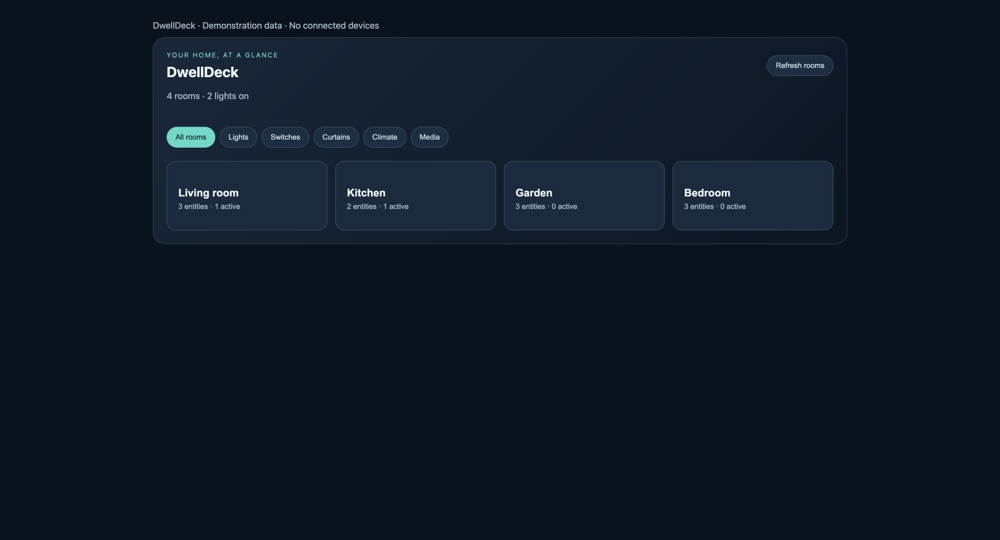

# DwellDeck

**Your home. Room by room.**

A configurable Home Assistant dashboard that turns your areas into room cards with matching popup controls. Discover rooms automatically, or build your own with visual entity pickers. No template editing or extra card plugins required.

**Status: v0.1.0 alpha.** Room discovery has automated tests and the mock preview has been checked. Installation and native controls still need validation on a real Home Assistant instance. HACS distribution is prepared but has not been verified through a published repository.

DwellDeck is a standalone dashboard card. It does not replace Home Assistant automations, provide irrigation scheduling, or migrate other dashboards.



## Features

- Automatic room discovery from Home Assistant areas and device assignments.
- **Add room** button with room name, icon, area and entity pickers.
- Optional exclusions per room; combine area discovery with manually selected entities.
- Room popups generated from the same entities as the room card.
- Lights, switches, curtains, climate, media, cameras and sensors.
- Optional weather, home power, solar power and battery cards.
- Native Home Assistant controls, responsive layout, no other custom card dependencies.
- No account, cloud service, analytics, credentials, external scripts or build step.

## Install manually

1. Download `dwelldeck.js` from this repository.
2. Copy it to your Home Assistant configuration folder at `www/dwelldeck.js`. Create `www` if needed.
3. Under **Settings → Dashboards → ⋮ → Resources**, add `/local/dwelldeck.js?v=0.1.0` as **JavaScript module**. Resources may require Advanced mode in your user profile.
4. Refresh your browser.
5. Create a dashboard, choose **Edit dashboard → Add card**, search for **DwellDeck**, and select it.
6. Keep automatic rooms enabled, or click **Add room** to select your own entities. Click **Save**.

For a full-width dashboard, create a Panel view and add this card, or copy `examples/dashboard.yaml` into a new dashboard's raw configuration editor. Do not overwrite an existing dashboard you want to keep.

## Install with HACS

After this folder has been published as its own GitHub repository:

1. Open HACS and add **that repository URL** under Custom repositories, with type **Dashboard** (called Plugin in some versions).
2. Download DwellDeck and refresh the browser.
3. Confirm the resource exists; if HACS did not register it, add `/hacsfiles/dwelldeck/dwelldeck.js` as a JavaScript module. This assumes your repository is named `dwelldeck`; use its actual folder name otherwise.
4. Add the **DwellDeck** card and configure it visually.

HACS metadata is included, but installation through a published HACS repository has not yet been verified. The package is not listed in the HACS default store.

## Configure

### Easiest: automatic rooms

Leave **Automatically show Home Assistant rooms** enabled. Optionally select included areas and entity types. The dashboard reads the area, entity and device registries; it respects disabled and hidden entities. An entity's own area takes priority over its device's area.

New devices appear on **Refresh rooms**, or within one minute. Rooms with no matching entities are omitted. If registry access fails, a message appears and manual entity configuration still works.

### Add a custom room

1. Edit the DwellDeck card.
2. Click **+ Add room**.
3. Enter a name, for example Garden.
4. Choose an existing Home Assistant area, select individual entities, or combine both.
5. Optionally exclude entities or change the icon.
6. Click Home Assistant's **Save** button.

The popup buttons follow the room configuration automatically. There is no second popup list to maintain. To customize an automatically discovered room, add a room and select that same area; the custom room replaces its automatic entry.

The editor configures this dashboard only. Create areas and assign devices in **Settings → Areas, labels & zones**.

### Optional YAML

```yaml
type: custom:dwelldeck-card
title: My Home
auto_areas: true
domains:
  - light
  - switch
  - cover
  - climate
  - media_player
rooms: []
```

All optional sensor fields start empty. The package contains no household-specific entity IDs or server addresses.

## Controls and permissions

Room buttons open a popup. In that popup, light, switch and fan icons toggle their entity; the tile body opens More info. Climate, media and cameras use native cards. Other tile icons open More info. The dashboard does not change automations or control a device merely by being opened or configured. Home Assistant permissions still apply.

Configuration is saved by Home Assistant with the card, shared across browsers and included in normal Home Assistant backups. Browser-local storage is not used for settings. Camera cards use your installed camera integration; they do not guarantee live streams.

## Publish to GitHub

Upload the **contents of this folder** to the root of a new public repository, for example `dwelldeck`. Keep `dwelldeck.js`, `hacs.json`, `README.md` and `LICENSE` at the repository root. Create a `v0.1.0` release and attach the JavaScript file. Share the repository link so users can follow either installation method. Do not upload private dashboard backups or Home Assistant configuration files.

This package follows [HACS dashboard repository structure](https://hacs.dev/docs/publish/plugin/) and [Home Assistant custom card/editor APIs](https://contributors.home-assistant.io/frontend/custom-ui/card-editor/).

## Development and verification

Requires Node.js 22 or newer for the included checks. No npm dependencies.

```sh
npm run check
npm test
```

Tests cover room discovery, device/entity area precedence, hidden/disabled filtering, exclusions, deduplication, manual rooms and newly discovered devices. GitHub Actions runs these checks on pushes and pull requests.

For a mock preview, run `python3 -m http.server 8765` in this folder and open `http://localhost:8765/demo/`. This uses demonstration data and mock native controls. It does not test actual Home Assistant card rendering, device services or registry permissions. Verify the initial release on your Home Assistant installation before recommending it broadly.

## Remove or update

To update, replace the JavaScript file, change the resource URL version and refresh. To remove, remove the dashboard card and resource. No entities, areas or automations need to be deleted.

MIT licensed. See `LICENSE`.
